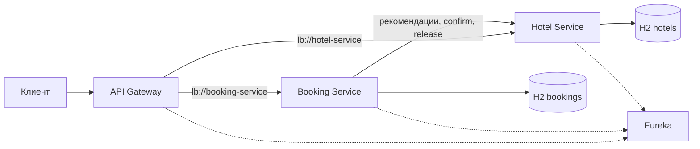

# Бронирование отелей

Учебный REST API на Java 17 и Spring Boot 3.5.14. Пользователь выбирает номер сам или просит подобрать свободный. Администратор управляет пользователями и каталогом, а также смотрит загрузку номеров за период.

## Запуск на Windows

Понадобятся JDK 17 и Maven 3.9. Команды ниже выполняются в PowerShell из папки, где лежит корневой `pom.xml`. Maven при первой сборке скачает библиотеки из Maven Central. Версии Spring Cloud согласованы через BOM 2025.0.3. [Таблица совместимости Spring Cloud и Spring Boot](https://spring.io/projects/spring-cloud#overview).

```powershell
java -version
mvn -version
mvn clean verify
powershell -NoProfile -ExecutionPolicy Bypass -File .\run.ps1
```

Скрипт запускает четыре JAR-файла и показывает пароль пользователя `admin`. Оставьте терминал открытым. Дождитесь регистрации приложений в Eureka и откройте Swagger. Для остановки нажмите **Ctrl+C** в том же терминале. Логи каждого приложения лежат в `target/run`.

| Модуль | Порт | Назначение |
|---|---:|---|
| `discovery-server` | 8761 | Реестр сервисов. [Панель Eureka](http://localhost:8761) |
| `api-gateway` | 8080 | Вход для клиентов. Принимает запросы к `/api/…`, проверяет JWT, передаёт токен и идентификатор запроса |
| `hotel-service` | 8081 | Каталог, занятость по датам, статистика и подтверждение слотов. [Swagger UI](http://localhost:8081/swagger-ui/index.html) |
| `booking-service` | 8082 | Аккаунты, выпуск JWT, история и оформление брони. [Swagger UI](http://localhost:8082/swagger-ui/index.html) |
| `common` | — | Библиотека с общими контрактами, проверкой JWT и форматом ошибок |

При запуске скрипт генерирует общий ключ JWT и временный пароль администратора. Можно заранее задать `JWT_SECRET` (Base64, минимум 32 случайных байта) и `ADMIN_PASSWORD` (от 8 символов, до 72 байт UTF-8). При ручном запуске JAR задайте эти переменные в окружении процессов. Спецификация OpenAPI доступна на портах 8081 и 8082 по пути `/v3/api-docs`. В Swagger кнопка **Authorize** принимает значение поля `token` из ответа регистрации или входа.

## Пример бронирования

Откройте второй терминал PowerShell. Пример регистрирует пользователя с уникальным логином, запрашивает номера первого отеля и создаёт бронь на две ночи.

```powershell
$api = 'http://localhost:8080/api'
$credentials = @{
    username = 'guest-' + [guid]::NewGuid().ToString('N').Substring(0, 8)
    password = 'guest-password'
}
$auth = Invoke-RestMethod -Method Post -Uri "$api/bookings/user/register" `
    -ContentType 'application/json' -Body ($credentials | ConvertTo-Json)
$headers = @{Authorization = "Bearer $($auth.token)"}

$arrival = (Get-Date).AddDays(10).ToString('yyyy-MM-dd')
$departure = (Get-Date).AddDays(12).ToString('yyyy-MM-dd')
$query = "hotelId=1&startDate=$arrival&endDate=$departure"
Invoke-RestMethod -Uri "$api/rooms/recommend?$query" -Headers $headers

$request = @{
    requestId = [guid]::NewGuid().ToString()
    autoSelect = $true
    hotelId = 1
    startDate = $arrival
    endDate = $departure
}
$booking = Invoke-RestMethod -Method Post -Uri "$api/bookings" -Headers $headers `
    -ContentType 'application/json' -Body ($request | ConvertTo-Json)
$booking
Invoke-RestMethod -Uri "$api/bookings?page=0&size=10" -Headers $headers
Invoke-RestMethod -Method Delete -Uri "$api/bookings/$($booking.id)" -Headers $headers
```

При ручном выборе укажите `autoSelect = $false` и `roomId`. При автоподборе `roomId` игнорируется, а необязательный `hotelId` ограничивает поиск одним отелем. Для повторной отправки той же операции используйте прежний `requestId`. Для новой брони создайте новый UUID.

После старта в каталоге есть отели «Орбита» и «Нева». В первом доступны номера 101 и 102, номер 103 выведен из эксплуатации. Во втором доступен номер 201. Все счётчики начинают с нуля. Например, оформите две брони на разные будущие периоды в «Орбите». При первом автоподборе система выберет номер 101, при втором — 102, если обе брони остаются подтверждёнными.

## Эндпойнты

Все публичные пути в таблицах доступны через Gateway на порту 8080. Для защищённых операций передайте `Authorization: Bearer <token>`. Пользовательский JWT действует один час. Роль при открытой регистрации всегда `USER`. Менять роли может администратор. Каждая прикладная служба сама проверяет подпись, издателя и срок действия токена. Роль в уже выданном JWT действует до его истечения.

### Аккаунты и бронирования

| Метод и путь | Доступ | Что делает |
|---|---|---|
| `POST /api/bookings/user/register` | Все | Регистрация по `username`, `password`, возвращает токен |
| `POST /api/bookings/user/auth` | Все | Вход с теми же полями, возвращает токен |
| `GET /api/bookings/user`, `GET /api/bookings/user/{id}` | ADMIN | Список пользователей или один аккаунт |
| `POST /api/bookings/user` | ADMIN | Создание аккаунта по `username`, `password`, `role` |
| `PATCH /api/bookings/user/{id}`, `DELETE /api/bookings/user/{id}` | ADMIN | Обновление указанных полей или удаление аккаунта. При наличии истории удаление вернёт 409 |
| `GET /api/bookings/recommend` | USER | Рекомендации для `startDate`, `endDate`, необязательного `hotelId` |
| `POST /api/bookings` | USER | Создание брони. Обязательны `requestId`, даты и `autoSelect` |
| `GET /api/bookings` | USER | Только своя история, новые записи первыми. `page` с нуля, `size` от 1 до 100 |
| `GET /api/bookings/{id}`, `DELETE /api/bookings/{id}` | USER | Просмотр своей брони или отмена с освобождением номера. Чужой идентификатор возвращает 404 |

### Каталог и статистика

| Метод и путь | Доступ | Что делает |
|---|---|---|
| `GET /api/hotels`, `GET /api/hotels/{id}` | USER, ADMIN | Список отелей или один отель |
| `POST /api/hotels`, `PUT /api/hotels/{id}`, `DELETE /api/hotels/{id}` | ADMIN | Создание, замена данных, удаление. Поля для записи — `name`, `address` |
| `GET /api/rooms`, `GET /api/rooms/recommend` | USER, ADMIN | Свободные номера. Фильтры `hotelId`, `startDate`, `endDate`. Без дат проверяется ближайшая ночь с сегодняшнего дня |
| `GET /api/rooms/{id}` | USER, ADMIN | Карточка номера |
| `POST /api/rooms`, `PUT /api/rooms/{id}`, `DELETE /api/rooms/{id}` | ADMIN | Создание, замена данных, удаление. Поля — `hotelId`, `number`, `available`. Номер с действующей бронью удалить нельзя |
| `GET /api/rooms/stats` | ADMIN | Для периода `startDate`, `endDate` возвращает по каждому номеру количество броней, занятых ночей и процент загрузки. Можно отфильтровать по `hotelId` |

Внутренние `POST /api/rooms/{id}/confirm-availability` и `POST /api/rooms/{id}/release` доступны непосредственно на Hotel Service по служебному JWT с ролью `INTERNAL`. Оба принимают `bookingId`, `startDate`, `endDate`. В Gateway маршруты для этих операций закрыты.

## Архитектура и решения



**ADR 1. Кто определяет занятость.** Booking Service хранит историю пользователя. Hotel Service отвечает за календарь конкретного номера. В Hotel локальная таблица `bookings` хранит периоды и признаки отмены. Даты считаются как `[заезд, выезд)`, поэтому выезд одного гостя и заезд следующего могут приходиться на один день. При подтверждении транзакция берёт блокировку строки номера, проверяет пересечение и обновляет счётчик. Обычный поиск и рекомендации используют одинаковый фильтр доступности. Рекомендации дополнительно упорядочены по `times_booked ASC, id ASC`. Счётчик отражает количество неотменённых бронирований, включая завершившиеся. Занятость в процентах равна отношению занятых ночей к длительности выбранного периода.

**ADR 2. Как согласуются две базы.** Booking Service отдельной транзакцией сохраняет `PENDING`, затем обращается в Hotel. При подтверждении записывает `CONFIRMED`. Если номер занят при автоподборе, пробует следующего кандидата. При окончательном отказе или тайм-ауте записывает `CANCELLED` и, если номер уже выбран, отправляет `release`. Чтение из сети происходит за пределами транзакций БД. Время соединения ограничено одной секундой, ожидание ответа — двумя. Для временных ошибок предусмотрено до трёх попыток с паузами 150 и 300 мс. Circuit Breaker открывается при доле сбоев от 50% после минимум пяти вызовов, интервал перед пробой — десять секунд.

**ADR 3. Повторная доставка и потерянный ответ.** Для клиента ключом служит пара `(user_id, request_id)`. Одновременные повторы этой пары получают одну запись. Первый успешный ответ имеет статус 201, повтор готовой операции — 200, повтор ещё обрабатываемого запроса — 202. Изменение параметров при том же ключе даёт 409. Во внутренних вызовах ключом служит UUID брони. Повторное подтверждение и снятие слота сохраняют счётчик. Если отмена пришла раньше подтверждения, Hotel сохраняет отметку об отмене и отклоняет позднее подтверждение. При недоступности Hotel признак `release_pending` остаётся в базе Booking. Фоновая задача каждые 15 секунд повторяет незавершённые отмены. Для них разрешена отдельная попытка связаться с Hotel, даже когда цепь основных запросов разомкнута.

### Таблицы H2

| База и таблица | Содержимое и ограничения |
|---|---|
| Booking · `users` | Числовой ID, уникальный логин, BCrypt-хеш пароля, роль |
| Booking · `bookings` | UUID, внешний ключ пользователя, выбранный номер, даты, статус, время создания. Также ключ запроса, настройки автоподбора и признак незавершённого освобождения. Индексы для истории и фоновой задачи |
| Hotel · `hotels` | ID, имя и адрес |
| Hotel · `rooms` | Внешний ключ отеля, уникальный в отеле номер, `available`, `times_booked`. Индекс по доступности, счётчику и ID |
| Hotel · `bookings` | UUID брони, внешний ключ номера, даты и `released`. Индекс по номеру, отмене и датам ускоряет поиск пересечений |

`available` описывает состояние самого номера, например ремонт. Промежуток занят, когда в календаре есть неотменённая запись с пересечением дат. Базы работают в памяти и создаются заново при запуске. Для чистой демонстрации перезапустите весь комплект. Инфраструктурные приложения Gateway и Eureka не хранят предметные данные.

## Проверка

`mvn clean verify` компилирует модули, запускает тесты JUnit 5 и собирает четыре исполняемых JAR. Отдельный сервер Eureka для тестов не требуется. MockMvc проверяет REST API обоих прикладных сервисов на H2, а WebTestClient проверяет Gateway с настоящими подписанными JWT. Тестовый HTTP-сервер работает на случайном локальном порту. В сценарии тайм-аута он успевает записать слот до задержки ответа — тест проверяет, что компенсация его освобождает.

| Набор | Что проверяется |
|---|---|
| `HotelApiTest` | Восемь запросов на один период, повторные confirm/release, поздний confirm, граница дат, рекомендации и статистика, роли и CRUD |
| `BookingApiTest` | Успех, чужая бронь, пагинация, параллельные повторы, валидация дат, учётные записи, HTTP 503 и тайм-аут, отложенное освобождение, открытый Circuit Breaker |
| `GatewayApiTest` | Маршруты, передача JWT и traceId, истёкший токен, блокировка внутренних маршрутов |

Для сквозной проверки остановите обычный запуск и выполните команду ниже. Скрипт поднимет все четыре приложения на штатных портах, пройдёт через настоящий Eureka и Gateway, затем остановит процессы. Он проверяет параллельный автоподбор, повторную доставку, конфликт дат, отмену, равномерное распределение по счётчику и обе страницы Swagger.

```powershell
powershell -NoProfile -ExecutionPolicy Bypass -File .\run.ps1 -SmokeTest
```

Ошибки API содержат `timestamp`, `status`, `message`, `path`, `traceId`. Основные статусы — 400 для некорректного запроса, 401 для ошибки аутентификации, 403 для недостаточных прав, 404 для неизвестной записи, 409 для конфликта. При исчерпании попыток связи с Hotel используются 502 или 504, при открытой цепи — 503.

Gateway возвращает `X-Request-Id` и передаёт его по цепочке. В JSON-логах события `booking.state`, `slot.confirmed`, `slot.released` и `booking.release.completed` связаны общим `bookingId`. Например, после демонстрации подставьте UUID брони в команду поиска.

```powershell
Select-String -Path .\target\run\*.log -SimpleMatch -Pattern '<UUID брони>'
```
